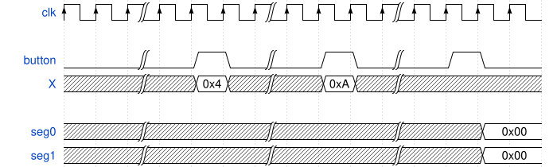

# Student Instructions – Mini Calculator

## 1. Goal

Design a small digital system implementing a mini adder controlled by a single button and a finite state machine (FSM).

The system sequentially captures two 4-bit operands, computes their sum, and displays the result on two 7-segment displays.

The control button is considered ideal, meaning it produces a single-clock-cycle pulse synchronized to clk (see below).

## 2. System Specifications

### External Interface

#### Inputs

1. `clk` - System clock
2. `rst_n` - Active-low synchronous reset (High value means no reset)
3. `button` - Ideal button: synchronized, debounced, single-cycle pulse
4. `X[4:0]` - 4-bit input bus

#### Outputs

1. `seg0[6:0]` - 7-segment display for first digit (4-bit value, active-low)
2. `seg1[6:0]` - 7-segment display for last digit (4-bit value, active-low)

### Functional Behavior

The system operates in a sequential manner using a simple FSM and a single control button. The intended usage sequence is:

1. The user sets the input bus in[3:0] to operand A
2. The user presses the control button → operand A is stored
3. The user sets the input bus in[3:0] to operand B
4. The user presses the control button → operand B is stored
5. The system computes A + B
6. On the next button press, the system display is updated to show the result, and operation returns to step 1

This sequence repeats indefinitely.

### Example Waveform

The waveform below shows how chip will work:



### Functional Behavior

The system is based on a circular FSM. Each press of `button` captures the current input and advances the state.
Two 7-segment displays show the complete values in hexadecimal form (two hex digits).

**Initial State:** Upon reset (`rst_n` = 0), the FSM must initialize to the `GET_A` state.

#### FSM sequence

1. `GET_A`
    - When `button` is pressed: capture the current value of `X[4:0]` into a register, advance to `GET_B`.

2. `GET_B`
    - When `button` is pressed: capture the current value of `X[4:0]` into another register, advance to `SHOW_RESULT`

3. `SHOW_RESULT`
    - When `button`is pressed: change the display value, which is stored in a register, return to `GET_A`.

The FSM always progresses forward; no backward navigation or editing is required.

### Specifications

#### Button Specification

The `button` signal is considered IDEAL, meaning:
- Already synchronized to the `clk` domain
- Already debounced (no mechanical bouncing)
- Produces exactly **one** clock cycle pulse per button press
- No additional debouncing or edge detection circuitry is required

#### Display Specification

**Two** 7-segment displays are used:
  * `seg0[6:0]`: displays the first value (bits 3:0)
  * `seg1[6:0]`: displays the last value (bits 7:4)
  * `seg` encoding: `seg[6:0] = {a, b, c, d, e, f, g}` (alphabetical order)

#### Reset Specification

- `rst_n` is active-low and synchronous
- When `rst_n` = 0: system initializes to `GET_A` state with all registers cleared
- When `rst_n` = 1: normal operation

### Architecture

The chip architecture is shown in the following.


The main data path consists of the following modules:

- `adder`: stores the operands and computes the result
- `bcd_convert`: convert the result to two BCD values
- `seven_segment`: convert BCD value to seven segment (and stores the last one)
- `controller`: controls the operation based on the button pushes

## 3. Module Development and Simulation

### 3.1 Module Organization

The system is divided into four modules, labeled M1 to M4. Each module implements a specific functional block of the system.

The corresponding directory contains:

1. A SystemVerilog (.sv) template with the module interface already defined.
2. Test files to verify the expected behavior.
3. A Makefile to execute the module simulation.

### 3.2 Implementation

For each module:

1. Navigate to the corresponding module directory (M1, M2, M3, or M4).
2. Open the provided .sv template.
3. Complete the module implementation according to its specifications.
4. Keep the predefined module interface unchanged.
5. Run the provided tests to verify your implementation.

### 3.3 Running the Tests

Once the SystemVerilog implementation is complete, open a terminal in the corresponding module directory and execute:
```
make
```

This command runs the provided simulation and tests for the module.

If the tests fail, review the simulation output, correct your implementation, and run the tests again. Repeat this process for all four modules. Each module should pass its individual tests before proceeding to the complete FPGA implementation.

## 4. FPGA Implementation

After completing and testing all four modules, the next step is to implement the complete system on an FPGA.

The FPGA implementation flow is:
```
SystemVerilog
     |
     v
  Synthesis
   (Yosys)
     |
     v
Place & Route
(nextpnr-xilinx)
     |
     v
Bitstream Generation
   (fpga-as)
     |
     v
FPGA Programming
 (openFPGALoader)
```

The required tools for synthesis, place-and-route, and bitstream generation are already installed inside the Dev Container.

However, FPGA programming must be performed outside the Dev Container, using openFPGALoader installed on your host operating system.
### 4.1 Installing the Required Tools

To program the FPGA, you must install:

1. openFPGALoader: Used to detect and program the FPGA.
2. GNU Make: Used to execute the commands defined in the Makefile.

If you haven't installed them yet follow the installation isntructions on the [troubleshooting](../docs/troubleshooting.md)

### 4.2 Using the Makefile

The Makefile provided in this folder contains the commands required to perform the FPGA implementation flow, starting from the SystemVerilog source files and ending with FPGA programming.

To see the available commands, execute:
```
make help
```
The implementation flow must be executed in two different environments:

| Task | Environment |
|---|---|
| SystemVerilog development | Dev Container |
| Module simulation | Dev Container |
| Synthesis | Dev Container |
| Place & Route | Dev Container |
| Bitstream generation | Dev Container |
| FPGA detection (`make detect`) | Host OS |
| FPGA programming (`make program`) | Host OS |

Important: Always execute make detect and make program outside the Dev Container. These commands use openFPGALoader installed directly on your computer.

### 4.3 Selecting Your FPGA Board

Different groups may use different FPGA development boards.

Before running the implementation flow, you must select the correct:

- **XDC file:** Defines the FPGA pin assignments and timing constraints.
- **BOARD:** Identifies the target development board used by openFPGALoader.

Both parameters can be passed directly to Make using the following syntax:

```bash
XDC=<constraints_file> BOARD=<board_name> make <target>
```

You must use the correct configuration for your assigned board.

#### Option A: Arty A7

For groups using an Arty A7-35T:

```bash
XDC=constraints_arty.xdc BOARD=arty_a7_35t make <target>
```

For example:

```bash
XDC=constraints_arty.xdc BOARD=arty_a7_35t make bitstream
```

For an Arty A7-100T, use `BOARD=arty_a7_100t` and ensure the XDC and FPGA device configuration match the 100T variant.

#### Option B: Nexys A7-100T

For groups using a Nexys A7-100T:

```bash
XDC=constraints_nexys.xdc BOARD=nexys_a7_100 make <target>
```

For example:

```bash
XDC=constraints_nexys.xdc BOARD=nexys_a7_100 make bitstream
```

**Important:** Use your board configuration consistently throughout the implementation flow.

The XDC file must correspond to your physical FPGA board. Incorrect pin assignments may prevent your design from working correctly.

The selected board must also match the FPGA device targeted by the synthesis and place-and-route flow.

### 4.4 Generating the Bitstream

**Inside the Dev Container**, navigate to the directory containing the FPGA Makefile.

Execute the bitstream generation target using your assigned board configuration.

**Arty A7-35T:**

```bash
XDC=constraints_arty.xdc BOARD=arty_a7_35t make bitstream
```

**Nexys A7-100T:**

```bash
XDC=constraints_nexys.xdc BOARD=nexys_a7_100 make bitstream
```

The Makefile executes the required implementation steps using the tools installed in the Dev Container.

After successful execution, a `.bit` file will be generated.

This file contains the configuration data required to program your FPGA.

### 4.5 Detecting the FPGA

**Exit the Dev Container or open a separate terminal on your host operating system.**

Connect the FPGA development board to your computer using its programming USB port.

Navigate to the project directory containing the Makefile.

Run:

**Arty A7-35T:**

```bash
XDC=constraints_arty.xdc BOARD=arty_a7_35t make detect
```

**Nexys A7-100T:**

```bash
XDC=constraints_nexys.xdc BOARD=nexys_a7_100 make detect
```

If the FPGA is correctly connected and accessible, openFPGALoader should report information about the detected JTAG device.

If detection fails:

1. Verify that the FPGA is powered on.
2. Check the USB cable and programming port.
3. Verify that openFPGALoader is installed.
4. On Linux, check the USB permissions.
5. On Windows, check the USB driver configuration.

### 4.6 Programming the FPGA

Once the bitstream has been generated and the FPGA has been detected, you can program the board.

**This step must be executed outside the Dev Container.**

From the project directory, execute:

**Arty A7-35T:**

```bash
XDC=constraints_arty.xdc BOARD=arty_a7_35t make program
```

**Nexys A7-100T:**

```bash
XDC=constraints_nexys.xdc BOARD=nexys_a7_100 make program
```

The Makefile will invoke openFPGALoader to load the generated bitstream into the FPGA.

The programming process does not require Yosys, nextpnr-xilinx, or the FPGA chip database on your host computer.

**Note:** The default programming procedure loads the bitstream into the FPGA's volatile configuration memory. The configuration will be lost when the board is powered off.

### 4.7 Testing the Design on Hardware

After programming, verify that the mini calculator behaves as expected.

1. Reset the system.
2. Set operand A using the FPGA input switches.
3. Press the control button to store operand A.
4. Set operand B using the FPGA input switches.
5. Press the control button to store operand B.
6. Press the control button again to update the displays.
7. Verify that the two 7-segment displays show the expected result.
8. Repeat the procedure with different operands.

Compare the observed hardware behavior with the expected simulation results.

